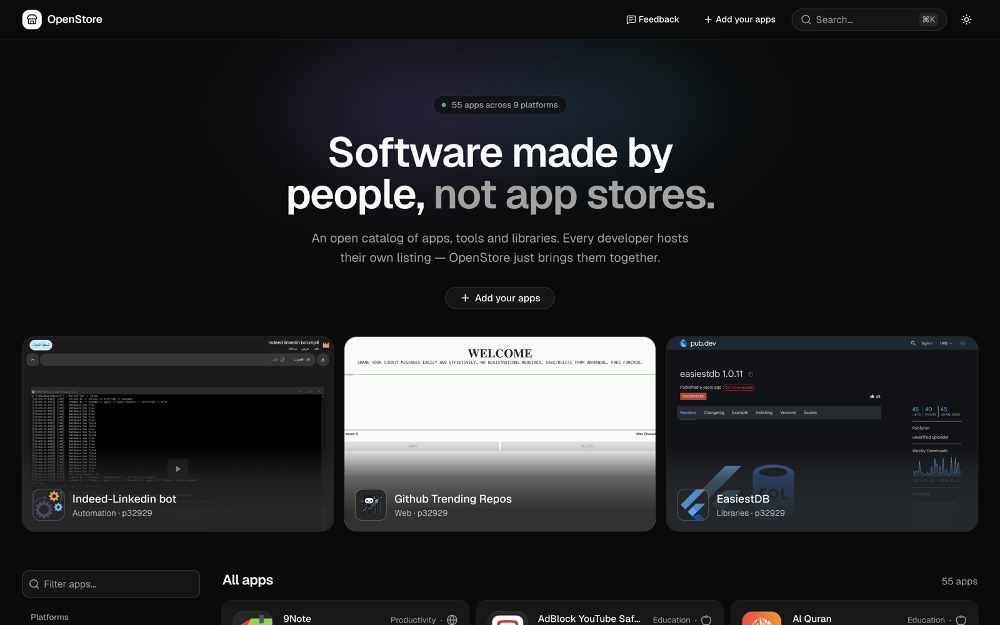
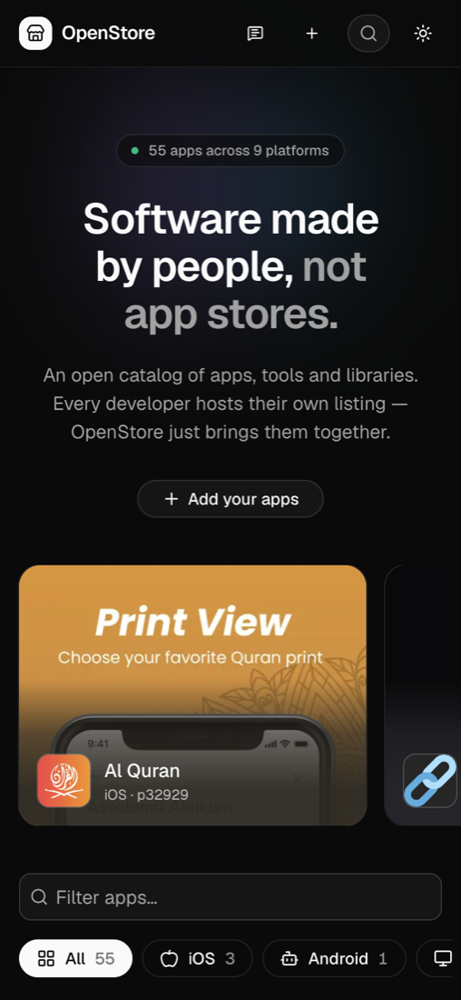

<h1 align="center">OpenStore feedback</h1>

<b>Software made by people, not app stores.</b> 
Bugs, ideas, questions and app reports for <a href="https://openstore.pfay.workers.dev">OpenStore</a>, the app store for independent developers.

<a href="https://openstore.pfay.workers.dev"><b>Open the store →</b></a> &nbsp;·&nbsp; <a href="https://openstore.pfay.workers.dev/add"><b>Add your apps</b></a> &nbsp;·&nbsp; <a href="https://openstore.pfay.workers.dev/why">Why OpenStore</a>

  
  

## What is OpenStore?

An open catalog of apps, tools and libraries. Every developer keeps their own listing in their own GitHub repo, so it is free, there is nothing to wait for, and nobody can take it away. OpenStore's code isn't public, but everything about it can be discussed here.

## Where to post

| You want to… | Go to |
|---|---|
| Report something broken on the site | [New issue → Bug report](https://github.com/p32929/openstore_feedback/issues/new?template=bug.yml) |
| Suggest a feature or an improvement | [New issue → Suggestion](https://github.com/p32929/openstore_feedback/issues/new?template=suggestion.yml) |
| Report an app: broken download, misleading, harmful, spam, or listed by someone who didn't make it | [New issue → Report an app](https://github.com/p32929/openstore_feedback/issues/new?template=report-app.yml) (or "Report this app" on the app's page) |
| Ask a question, or show what you built | [Discussions](https://github.com/p32929/openstore_feedback/discussions) |
| Report a security problem | [Privately](https://github.com/p32929/openstore_feedback/security/advisories/new), not in a public issue |

Before opening an issue, please search the [existing ones](https://github.com/p32929/openstore_feedback/issues?q=is%3Aissue). If yours is already there, add a 👍 or a comment instead.

## Want your apps on OpenStore?

It takes four steps, and you only need Node.js:

1. Copy the [template](https://github.com/p32929/p32929_openstore/tree/template) into a new public repo.
2. Add one `.md` file per app.
3. Run `node validate.mjs` (or check online at [openstore.pfay.workers.dev/validate](https://openstore.pfay.workers.dev/validate)).
4. Open one pull request on [openstore_maintainers](https://github.com/p32929/openstore_maintainers).

Full guide: [openstore.pfay.workers.dev/add](https://openstore.pfay.workers.dev/add).

- **Your listing has errors?** Every message says which file and line to fix.
- **Something wrong with your app's page?** Change the app's file in your repo and push. The store picks it up within a day.
- **Stuck?** Ask in [Discussions → Q&A](https://github.com/p32929/openstore_feedback/discussions/categories/q-a).

## Related

- [openstore_maintainers](https://github.com/p32929/openstore_maintainers): the list of developers on OpenStore
- [Listing template](https://github.com/p32929/p32929_openstore/tree/template): the starter repo
- [Why OpenStore](https://openstore.pfay.workers.dev/why)

Be kind. Apps on OpenStore are made by individuals, often in their spare time.
